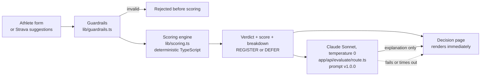

# Finish Line · Plan

## Problem
A first-time triathlete asks one question before paying an entry fee: am I actually ready for this race? Most people answer it on optimism. A wrong "you're ready" is the expensive mistake, because it shows up on race day in open water.

## Approach
One rule shapes the whole build: **the system decides, the model explains.**

- **Guardrails** reject impossible inputs (more than 168 training hours a week, race dates in the past, prompt-injection text) before they can touch a verdict.
- **Scoring engine** owns the verdict. Hard rules come first (can't swim, Full Ironman with no prior triathlon, distance and swim combinations), then six scored dimensions: timeline, swim, run, bike, lifestyle, experience.
- **Claude** writes the explanation for a verdict the engine already made. The engine's fields are merged last, so the model can never change the verdict.
- **Strava** (optional, OAuth, read-only scope) suggests form values through a mapper with seasonal lookback windows. Suggestions are shown, never silently applied. The access token is used once and discarded.

## How quality is checked
- `lib/evals/eval-dataset.json`: 20 cases across 5 personas, expected verdicts set from race experience. Run with `npx tsx lib/evals/eval-runner.ts` (20/20 at last run).
- Explanation quality was graded with an LLM-as-judge (Phase 3): a separate call with the score breakdown and a rubric.
- Every Claude call logs prompt version, tokens, latency, verdict and score.

## Risks and how they're handled
| Risk | Handling |
|---|---|
| Model is slow (measured 18–20 s end to end with the explanation inline) | Verdict returns from the engine first; the explanation loads after |
| Model fails or times out | 30 s timeout, one retry; the verdict and breakdown still show, with a retry for the explanation |
| Explanation contradicts the scores | LLM-as-judge with the breakdown beside the explanation |
| Model behaviour drifts without a deploy | Versioned prompt; evals to run on a schedule (next) |
| Bad or hostile input | Guardrails before scoring |

## What's next
1. Run the evals (verdict and judge) in CI on every commit, and on a schedule for drift.
2. Retrieval over race data and current race conditions, so explanations can cite a source.
3. Agents that bring in real race information and community signal before the explanation is written (Phase 5).
4. Test a smaller model against the same eval set, since the verdict never depends on the model.
